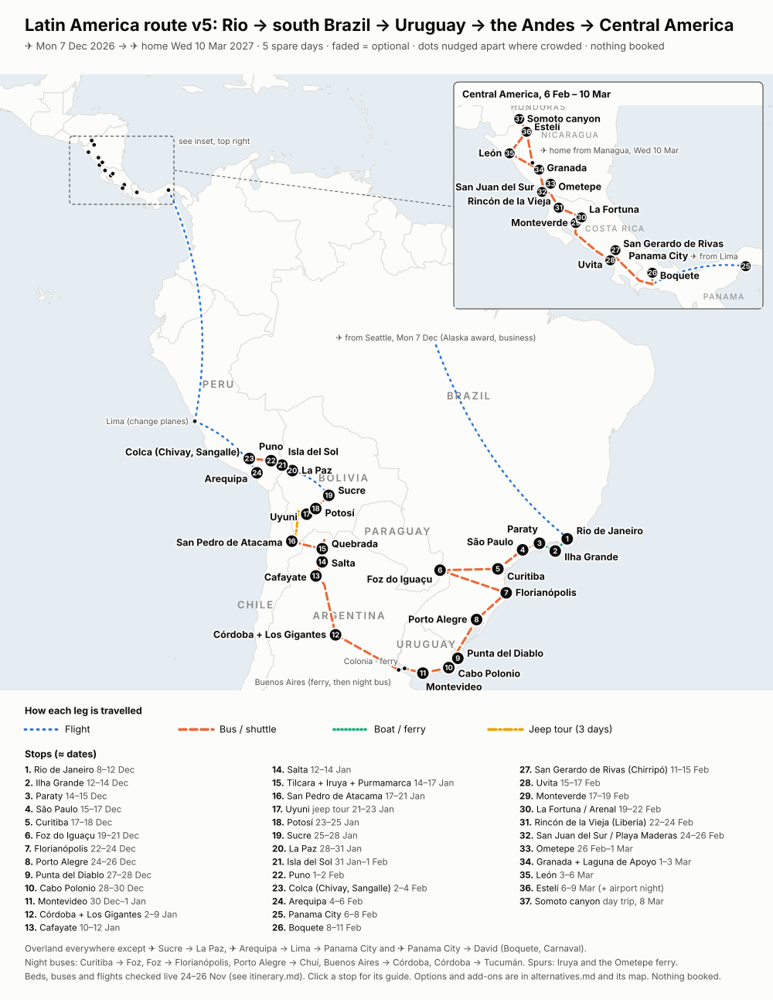

# Latin America itinerary, route v5 (Day 1 → 94)

**Status:** draft for review. **Nothing is booked.**
- **Trip days, not dates (27 Nov).** **Day 1 = Tue 8 Dec 2026**, arrival in Rio (`start` in [schedule.json](schedule.json)); Day 0 is the flight there. Every guide, table and map counts trip days ("Day 41", "Day 41 → 45" = arrive → leave), so the plan can be shared and shifted without rewriting it. Only fixed-calendar facts (Christmas, Carnaval, holidays), check dates and the dates inside booking links stay as real dates.
- **To move things:** change `start` (whole trip) or a stay's `nights` in schedule.json and run `python3 tools/latam/reschedule.py --apply`. It renumbers later trip days, recomputes holiday tags, moves every booking-link date and redraws both maps; then re-check the weekday-only services it lists.
- Beds, buses, ferries and flights were checked live on **24 Nov 2026** for the exact dates and 1 adult, in **USD**.
- ✅ = read on the operator's or property's own site. ≈ = estimate or an aggregator/AI summary.
- Dates assume the **Alaska business award on Day 0** (SEA 09:15 → PHL → MIA → AA905 → Rio Day 1 09:25, 60k + $26). Booking a different date shifts everything by the same amount.

Route and reasoning: [route-v5-brainstorm.md](route-v5-brainstorm.md). Map: [interactive route map](https://raw.githubusercontent.com/YellowViking/sabbatical-2026/latam-route-v5/trips/latam/latam-route-draft.svg) (click a stop for its guide) · [alternatives map](https://raw.githubusercontent.com/YellowViking/sabbatical-2026/latam-route-v5/trips/latam/latam-alternatives-map.svg).

🖱️ Click the map to open the interactive version, where each stop opens its guide.

## At a glance

| Dates | Stop (nights) | Dorm pick: total, channel | Private alt (location first) | Getting there | Guide |
|---|---|---|---|---|---|
| Day 1 → 5 | **Rio de Janeiro** (4) | Copacabana Central Hostel, $49, Booking | Studio da Lu, $154 | ✈ Alaska award; GIG → Copacabana by BRT + metro | [→](guides/rio-de-janeiro.md) |
| Day 5 → 7 | **Ilha Grande** (2) | Lila Limão, $45, Booking | Blue Door Brasil, $95 | 07:00 Costa Verde to Conceição de Jacareí + 09:30 Porto Real flex boat → Abraão 09:50, ≈ $23 (05:00 bus + 08:00 state ferry is $13; door-to-door van $44) | [→](guides/ilha-grande.md) |
| Day 7 → 8 | **Paraty** (1) | Girassol Hostel (location 9.7; kitchen; 4 min from the rodoviária), $12, Booking | Casa Nossa, $25 | Ferry + Colitur bus | [→](guides/paraty.md) |
| Day 8 → 10 | **São Paulo** (2) | Lamparina (curtains, stove), $27, Booking | Zen Hostel Brasil, $42 | ✅ Reunidas 09:00 → 15:40, $19.89 (MASP is free on Tuesdays) | [→](guides/sao-paulo.md) |
| Day 10 → 11 | **Curitiba** (1) + Serra Verde train | Residencial Botânico, $13, Booking | Studio Lifespace Batel, $50 | ✅ Penha 07:30 → 14:00, $19.60; ✅ train Day 11 08:30, R$70; bus back 16:10 | [→](guides/curitiba.md) |
| Day 11 → 12 | night bus | — | — | ✅ Catarinense 21:00 → 07:00, $48.70 | [→](guides/curitiba.md) |
| Day 12 → 14 | **Foz do Iguaçu** (2) | Hostel Bambu (curtains; pool and bar flagged), $33.60, Hostelworld | "Conforto e estilo" flat, $129 | Falls: Brazil side R$131, Argentina side ARS 60,000 | [→](guides/foz-do-iguacu.md) |
| Day 14 → 15 | night bus | — | — | ✅ Nordeste Foz 16:30 → Florianópolis 08:10, R$276.99 ($46.50) | [→](guides/florianopolis.md) |
| Day 15 → 17 | **Florianópolis** (2) | Pequi Hostel (location 9.8; quiet hours, kitchen), $31, Booking | | Bus 2120 Rita Maria → Lagoa (44 min) | [→](guides/florianopolis.md) |
| Day 17 → 19 | **Porto Alegre** (2, Christmas) | Nick Hostel Cidade Baixa (men-only dorm, location 9.1, kitchen), $21, Booking | Espaço Semente Poa Lírio (single), $29 | ✅ Nordeste Florianópolis 08:00 → 14:25, R$178.99 (≈ $30); leave the bag at the hostel on Day 19 (the Rodoviária's left-luggage shuts at 20:00 on Saturdays) | [→](guides/porto-alegre.md) |
| Day 19 → 20 | night bus | — | — | ✅ Planalto Porto Alegre 23:30 → Chuí 09:00, R$267.95 ($45) | [→](guides/porto-alegre.md) |
| Day 20 → 21 | **Punta del Diablo** (1) | Mar de Fondo Hostel (location 9.6; kitchen), $26, Booking | | ✅ COT Chuy 11:30 → Punta del Diablo 12:15; Santa Teresa park free | [→](guides/punta-del-diablo.md) |
| Day 21 → 23 | **Cabo Polonio** (2) | Hostel Albatros (location 9.4; kitchen), $70, Booking | | From Punta del Diablo via Rocha (Rutas del Sol 09:20, then 13:30 → gate 14:30) + 4x4 truck $12 return; no ATM | [→](guides/cabo-polonio.md) |
| 30 Dec → 1 Jan | **Montevideo**, New Year (2) | MedioMundo Hostel (no NYE surcharge), $50, Booking | | | [→](guides/montevideo.md) |
| Day 25 | Colonia stopover → ferry → night bus | — | — | COT 09:30 → Colonia 12:20, $14; ✅ Colonia Express 18:00 → BA 19:15, $48; El Práctico 22:20 → Córdoba 07:10, $44 | [→](guides/colonia.md) |
| Day 26 → 33 | **Córdoba** (2 + 1) + **Los Gigantes refugio** (2) + **Cerro Champaquí** (2, added 27 Nov) | Aldea Hostel, 3 nights $41, Booking; Club Andino refugio Day 28 → 30 (price on request); Champaquí: Valle del Tabaquillo refuge 7 → 8 (WhatsApp) + Hostel La Resolana, Villa Alpina, 8 → 9, $22 | | Free Condorito day trip Day 27 by COATA; Sarmiento bus to Los Gigantes Mon/Wed only; Champaquí: Lep to Villa General Belgrano + remís, free online declaration (guide optional) | [→](guides/cordoba.md) |
| Day 33 → 34 | night bus + Aconquija bus | — | — | Córdoba → Tucumán overnight; Aconquija 06:00 → Cafayate via Tafí | [→](guides/cafayate.md) |
| Day 34 → 36 | **Cafayate** (2) | Cielito Lindo, $28.80, Hostelworld/Agoda | La Montaña B&B, $86 | | [→](guides/cafayate.md) |
| Day 36 → 38 | **Salta** (2) | Clivias Hostel, $30, Booking | Casa Puka (curtains), $23.50 (backup) | ✅ Flecha Bus 11:30 → 15:20, ≈ $18 | [→](guides/salta.md) |
| Day 38 → 41 | **Tilcara** (1) + **Iruya** (1, new 26 Nov) + **Purmamarca** (1) | Tilcara Mística $23 + Hospedaje Ale (private; Iruya has no dorms) $37 + Giramundo $17, Booking | Nido de Cóndores (quiet), $65 | Humahuaca → Iruya 08:20 (≈ 3 h, gravel road; can wash out in January) | [→](guides/quebrada-de-humahuaca.md) |
| Day 41 | over the Andes | — | — | ✅ **Andesmar Purmamarca 03:40 → San Pedro 11:30**, ARS 120,000 (Plataforma10, 26 Nov) | [→](guides/san-pedro-de-atacama.md) |
| Day 41 → 45 | **San Pedro de Atacama** (4; +1 on 27 Nov) | Hostal Lackuntur (location 9.4, 4-bed dorm, kitchen; 12 min on foot from the terminal), $73 (4 nights), Booking | Hostal Ayni, $180 (4 nights) | Cerro Toco Day 44, Vulcano CLP 85,000 ≈ $83 (Day 43 is the weather buffer) | [→](guides/san-pedro-de-atacama.md) |
| Day 45 → 47 | **Jeep tour to Uyuni** (2) | Estrella del Sur, $260–280 + Bs 210–250 park/border fees (cash) | backup World White Travel $275 | Incahuasi often skipped in January (flooding); mirror effect likely | [→](guides/uyuni-jeep-tour.md) |
| Day 47 → 49 | **Potosí** (2; 2nd night added 26 Nov, LP pick: mine + mint) | Los Faroles (private; no decent dorm), $57, Booking | Colonial, ≈ $120 | Uyuni → Potosí 15:00–18:30, $11–15 | [→](guides/potosi.md) |
| Day 49 → 52 | **Sucre** (3) | Villa Oropeza (curtains, 2 kitchens), $17, Agoda | Los Balcones, $50 | Potosí → Sucre 13:00/14:00, $7–8 | [→](guides/sucre.md) |
| Day 52 | ✈ | — | — | ✅ BoA via Cochabamba 09:05 → 11:25, $49 (no nonstop) | [→](guides/la-paz.md) |
| Day 52 → 55 | **La Paz** (3) | Casa Bonita (by the bus terminal), $36, Hostelworld/Agoda (✅ 27 Nov; was $20.39) | Nuevo Sol, $93 | Death Road ≈ $85; Pico Austria ≈ $80–115 | [→](guides/la-paz.md) |
| Day 55 → 56 | **Isla del Sol** (1; the Copacabana night went to Potosí) | Inti Wasi Lodge, $18, Booking | Hostal Inti Wayra, $26 | La Paz → Copacabana 07:30, $7; boat 13:30; back Mon for the **18:00** Puno bus (or the 10:30 boat + 13:30 bus) | [→](guides/copacabana-isla-del-sol.md) |
| Day 56 → 57 | **Puno** (1) | Kantaya Hostel, $10.50, Hostelworld | | ✅ Titicaca Bolivia Bus 18:00 → ≈ 21:00, $9 (13:30 if you skip the ridge walk) | [→](guides/puno.md) |
| Day 57 → 59 | **Chivay** (1) + **Sangalle oasis** (1) | Samay Lodge $12 + Paraíso Las Palmeras $32, Booking | | ✅ 4M Express Puno 06:15 → Chivay ~12:30, $54; boleto turístico S/70 | [→](guides/colca-canyon.md) |
| Day 59 → 61 | **Arequipa** (2) | Econunay, $18.94, Hostelworld/Agoda | | Climb out of the canyon 05:00, 09:30 bus from Cabanaconde, S/35 | [→](guides/arequipa.md) |
| Day 61 | ✈ ✈ (**3 open options**) | — | — | **A:** Sky 06:50 + Copa CM760 13:20, $326 cash (two tickets, 4 h 45 gap). **B:** Lima night + Copa 10:30 on 17,500 United miles. **C:** overland via Huacachina + Paracas, award from Lima on Day 65 (+3 days) | [→](guides/panama-city.md) |
| Day 61 → 64 | **Panama City** (1 + 1, around San Blas) | El Machico (curtains, big kitchen; keeps the pack), $19 + $19, Booking | | Tocumen → city by Metro, $0.85 | [→](guides/panama-city.md) |
| Day 62 → 63 | **San Blas** (1, island tour; added 27 Nov) | 2-day tour from Panama City, ≈ $180–209 + $22 Guna Yala tax (cash) | | ≈ 05:00 hostel pickup, back the next afternoon | [→](guides/san-blas.md) |
| Day 64 → 67 | **Boquete** (3, Carnaval) | ONDA Boquete, $99.76 Agoda ($116 Booking) | | ✈ Air Panama 7P670 Albrook 07:15 → David on Carnaval Monday (Mon–Sat service), $67 (24 Nov) | [→](guides/boquete.md) |
| Day 67 → 71 | **San Gerardo de Rivas** (3, +1 on 27 Nov) + **Chirripó** (Base Crestones, Day 69 → 70) ⚠️ SINAC showed **0 permits** for every February night on 27 Nov: watch for cancellations | Casa Colibri Chirripó, $121 (3 nights around the Crestones night; $163 for 4 if there is no permit), Booking | | ✅ Tracopa Paso Canoas 08:00 → San Isidro; ✅ 14:30 bus → San Gerardo | [→](guides/san-gerardo-de-rivas.md) |
| Day 71 → 73 | **Uvita** (2) | Cascada Verde (location 9.0), $23, Booking | | | [→](guides/uvita.md) |
| Day 73 → 75 | **Monteverde** (2) | Monteverde Backpackers, $24, Hostelworld | | Buses via Quepos and Puntarenas | [→](guides/monteverde.md) |
| Day 75 → 78 | **La Fortuna** (3) | Ceiba Hostel (curtains, kitchen; small pool), $43, Booking (✅ 27 Nov) | | Jeep-boat-jeep | [→](guides/la-fortuna.md) |
| Day 78 → 80 | **Liberia / Rincón de la Vieja** (2) | Hostel Pura Vida, $28, Booking | | | [→](guides/rincon-de-la-vieja.md) |
| Day 80 → 82 | **San Juan del Sur** (2) | Hostel SaltWater (quiet, kitchen, breakfast; location 8.7), $25, Hostelworld (Nalu Nalu sold out, 27 Nov) | | CR exit $8 + Nicaragua entry ≈ $12–14 ($10 stamp + border charges), cash | [→](guides/san-juan-del-sur.md) |
| Day 82 → 85 | **Ometepe** (3) | Guest House Nena (private double, location 9.4, by the port), $36, Booking | | Ferry from San Jorge | [→](guides/ometepe.md) |
| Day 85 → 87 | **Granada** (1) + **Laguna de Apoyo** (1, new 26 Nov) | De Boca en Boca $14 + Coco Bay (lakeshore, location 9.6) $14, Booking | | Masaya volcano at night on Day 85 ($10 + ≈ $5 ride up) | [→](guides/granada.md) |
| Day 87 → 90 | **León** (3) | Casa Lula, $33, Booking | | Telica closed; El Hoyo overnight instead | [→](guides/leon.md) |
| Day 90 → 93 | **Estelí** (3) + **Somoto Canyon** day trip Day 92 (added 27 Nov) | Melody 78 (location 9.5), $42 (3 nights), Hostelworld | Casa Vínculos, $108 (3 nights) | ✅ León 05:20 → Estelí ≈ 08:20, C$110; guided Tisey and Miraflor days; ✅ Somoto: 05:30 bus C$46 + $30 tour | [→](guides/esteli.md) |
| Day 93 → 94 | Managua airport homestay (1) | Casa Robles MGA Airport Homestay (apartment, location 9.5), $17, Booking | | ✅ Estelí express → Mercado Mayoreo ≈ 2 h 30, C$110; the award leaves MGA at 07:00 | [→](guides/flight-home.md) |
| Day 94 | ✈ home | — | — | Alaska award MGA 07:00 → MIA → AS38 → PDX → SEA 22:39, 25k + $94.42 (9 seats, 27 Nov); cash ≈ $417 | [→](guides/flight-home.md) |

Every stop has its own guide in [`guides/`](guides/) (→ column): bed pick, backup and private alternative, getting there, things to do, food, and notes.

**On Google Maps (tagged 25 Nov):** everything in the guides is saved to the signed-in account, each with a visible note giving the date, the reason and the price.
- **Beds:** each night's pick is ⭐ **Starred**. Backups and private alternatives are in **🛏️ Beds – LatAm backups**, with their location score.
- **Sights:** in **Want to go**.
- **Food:** in **Restaurants**. **Drinking places:** in **Craft beer 🍺**.
- **Hikes, walks and bike routes:** in **🥾 Hikes – LatAm**, **🚶 Walks – LatAm** and **🚲 Bike – LatAm**.
- **Not on Google Maps, so not saved:**
  - Beds: Hostel Residencial Botânico (Curitiba pick), and the private alternatives Lobolira, Blue Door Brasil and Studio da Lu.
  - Places: the Cabo Polonio sea-lion colony and Los Gigantes' Cueva de la Salamanca.

## Book these first (they sell out or need you)
Every guide also has a **Book (one click)** table at the top, with dates and 1 adult pre-filled.

| # | What | Why now | One click |
|---|---|---|---|
| 0 | 🛂 **Brazil e-visa** (US$80.90) | Required for US citizens; takes up to 10 business days, and you land Day 1, so **apply today** | [Official e-visa portal (VFS)](https://brazil.vfsevisa.com/) |
| 1 | ✈ Alaska business award SEA → Rio, Day 0 (60k + $26) | 3 seats on 24 Nov; every date depends on it. Backup Day 2 | [Alaska award search](https://www.alaskaair.com/search/results?A=1&O=SEA&D=GIG&OD=2026-12-07&OT=Anytime&RT=false&UPG=none&ShoppingMethod=onlineaward&awardType=MilesOnly) · [Day 2](https://www.alaskaair.com/search/results?A=1&O=SEA&D=GIG&OD=2026-12-09&OT=Anytime&RT=false&UPG=none&ShoppingMethod=onlineaward&awardType=MilesOnly) |
| 2 | 🚌 Nordeste night bus Foz → Florianópolis, Day 14 16:30 (R$276.99), Nordeste Florianópolis → Porto Alegre, Day 17 08:00 (R$178.99) + Planalto Porto Alegre → Chuí, Day 19 23:30 (R$267.95) | Christmas-week buses; all on sale (27 Nov) | [ClickBus: Foz → Florianópolis](https://www.clickbus.com.br/onibus/foz-do-iguacu-pr/florianopolis-sc?departureDate=2026-12-21) · Planalto: see the [Porto Alegre guide](guides/porto-alegre.md) |
| 3 | Serra Verde Express Curitiba → Morretes, Day 11 08:30 (R$70) + Graciosa bus back 16:10 | 67 train seats and 10 bus seats left | [Train](https://www.serraverdeexpress.com.br/) · [Bus back (ClickBus)](https://www.clickbus.com.br/onibus/morretes-pr/curitiba-pr?departureDate=2026-12-18) |
| 4 | Christmas beds: Florianópolis, Pequi Hostel Day 15 → 17 ($31), and Porto Alegre, Nick Hostel Day 17 → 19 ($21) | Christmas week | [Pequi (Booking)](https://www.booking.com/hotel/br/pequi-hostel-florianopolis1.html?checkin=2026-12-22&checkout=2026-12-24&group_adults=1&no_rooms=1&group_children=0&selected_currency=USD) · [Nick Hostel, Porto Alegre (Booking)](https://www.booking.com/searchresults.html?ss=Nick+Hostel+Cidade+Baixa+Porto+Alegre&checkin=2026-12-24&checkout=2026-12-26&group_adults=1&no_rooms=1&selected_currency=USD) |
| 5 | Cabo Polonio, Hostel Albatros, Day 21 → 23 ($70) | Peak week; Viejo Lobo is already full on the 29th | [Booking](https://www.booking.com/hotel/uy/el-albatros.html?checkin=2026-12-28&checkout=2026-12-30&group_adults=1&no_rooms=1&group_children=0&selected_currency=USD) · [Agoda](https://www.agoda.com/partners/partnersearch.aspx?hid=1224576&checkin=2026-12-28&checkout=2026-12-30&NumberofAdults=1&Rooms=1) |
| 6 | Montevideo, MedioMundo, New Year 30 Dec → 1 Jan ($50); Punta del Diablo, Mar de Fondo, 27 → 28 Dec ($26) | New Year's Eve; peak week on the coast | NYE: [Booking](https://www.booking.com/hotel/uy/mediomundo-hostel.html?checkin=2026-12-30&checkout=2027-01-01&group_adults=1&no_rooms=1&group_children=0&selected_currency=USD) · [Hostelworld](https://www.hostelworld.com/hostels/p/268049/mediomundo-hostel/?from=2026-12-30&to=2027-01-01&guests=1) · [Agoda](https://www.agoda.com/partners/partnersearch.aspx?hid=1271943&checkin=2026-12-30&checkout=2027-01-01&NumberofAdults=1&Rooms=1) · Mar de Fondo: [Booking](https://www.booking.com/hotel/uy/mar-de-fondo-hostel.html?checkin=2026-12-27&checkout=2026-12-28&group_adults=1&no_rooms=1&group_children=0&selected_currency=USD) |
| 7 | Boquete, ONDA (Socialtel), Day 64 → 67 ($116) | Panama Carnaval 6–9 Feb, during the stay ($99.76 on Agoda, ✅ 27 Nov) | [Booking (search)](https://www.booking.com/searchresults.html?ss=Socialtel+Boquete+Boquete&checkin=2027-02-09&checkout=2027-02-12&group_adults=1&no_rooms=1&selected_currency=USD) · [Agoda](https://www.agoda.com/partners/partnersearch.aspx?hid=35353686&checkin=2027-02-09&checkout=2027-02-12&NumberofAdults=1&Rooms=1) · [✈ Air Panama to David](https://www.airpanama.com/) |
| 8 | Chirripó admission (Day 69) + Base Crestones bunk | ⚠️ SINAC showed **0 places** for every February night (27 Nov): watch for cancellations. **Needs you:** reCAPTCHA + SICORE account | [SINAC portal](https://serviciosenlinea.sinac.go.cr/) · [Base Crestones (Consorcio)](https://chirripo.org/info-util/) |
| 9 | Entry paperwork | **Yellow-fever certificate**, needed by Bolivia, Panama and Costa Rica; get the shot ≥ 10 days before Day 45 (Bolivia). Panama and Costa Rica also want an onward ticket (Panama also ~$500 proof of funds). Nicaragua's free advance registration by Day 73 | [Tica Bus (onward ticket)](https://www.ticabus.com/en/) · [Nicaragua registration](https://solicitudes.migob.gob.ni/) · [CDC: Panama entry](https://wwwnc.cdc.gov/travel/destinations/traveler/none/panama) · [CDC: Costa Rica entry](https://wwwnc.cdc.gov/travel/destinations/traveler/none/costa-rica) |
| 10 | Los Gigantes refugio, Day 28 → 30 | No published price, so message Club Andino Córdoba; bring a sleeping bag | see the [Córdoba guide](guides/cordoba.md) |
| 11 | 4M Express Puno → Chivay, Day 57 06:15 ($54) | Confirm by WhatsApp; bookings close 3 days before | [4M Express](https://www.4m-express.com/) |
| 12 | Andesmar Purmamarca → San Pedro, Day 41 03:40 | One departure a day; captcha-protected shop (also on [Plataforma10](https://www.plataforma10.com.ar/)) | [Andesmar shop](https://shop.andesmar.com/) |
| 13 | ✈ Flight home MGA → Seattle, Day 94 (25k + $94) | Book once the route is settled (9 seats on the AS38 routing, checked 27 Nov) | [Alaska award search](https://www.alaskaair.com/search/results?A=1&O=MGA&D=SEA&OD=2027-03-11&OT=Anytime&RT=false&UPG=none&ShoppingMethod=onlineaward&awardType=MilesOnly) |
| 14 | Puno, Kantaya Hostel, 1 → 2 Feb ($10.50) | The Candelaria festival is filling Puno: Booking shows 0 hostels, and both backups are sold out (27 Nov) | see the [Puno guide](guides/puno.md) |
| 15 | Cerro Champaquí refuge, Day 31 → 32 (Valle del Tabaquillo) + Hostel La Resolana, Day 32 → 33 ($22) | Refuges book by WhatsApp only; January is peak season | see the [Córdoba guide](guides/cordoba.md) |

## Alternatives (decide on the road)
The dropped Paraguay plan (Plan A), the three Arequipa → Panama options, optional add-ons for the 4 spare days left before 15 Mar, and the things to recheck before each stop are in **[alternatives.md](alternatives.md)**.

## Holiday backups (checked 25 Nov)
Every stay or leg that falls on a holiday has a backup: either shifted dates or a nearby town that isn't booked out. Each backup was checked live on Booking for the exact dates and 1 adult, and it's a one-click row in the guide's **Book** table (🎄 Christmas, 🎆 New Year, 🎭 Carnaval). "How tight" compares Booking's availability on our dates with the same nights a week later.

| Holiday | Stop or leg | How tight (25 Nov) | Backup: shift the dates | Backup: nearby town or other route |
|---|---|---|---|---|
| 🎄 Christmas, 24–25 Dec | [Porto Alegre](guides/porto-alegre.md), Day 17 → 19 | Booking still had 71 places rated 8+ (27 Nov); no public event on Christmas Eve | — | [Florianópolis](guides/florianopolis.md) for Christmas instead (Pequi, quiet hours, kitchen) |
| 🎄 Day 19 bus | Planalto Porto Alegre → Chuí, Day 19 23:30 | Runs on Day 19 (✅ 27 Nov), R$267.95 | — | Florianópolis → Montevideo by EGA/TTL (Saturdays only, 14:30/15:00) |
| 🎆 New Year week | [Cabo Polonio](guides/cabo-polonio.md), 28 → 30 Dec | 5 hostels left (Albatros $70, Lobo $61, Hostal del Cabo $86); Punta del Diablo is 83% unavailable | — | **Barra de Valizas**, the next village (bus stop on the same Rutas del Sol line): Valizas 1900, dorm, location 9.5, **$38** |
| 🎆 New Year's Eve | [Montevideo](guides/montevideo.md), 30 Dec → 1 Jan | Only **5 hostels** rated ≥ 8 are left; MedioMundo is still $50 | — | Circus Hotel (dorm, location 9.2, 2,865 reviews), **$32**. Or New Year in **Colonia**: Casarão Sacramento, dorm, location 9.8, $40 (Colonia is 86% unavailable). That also removes the 1 Jan Montevideo → Colonia bus, which runs no published holiday timetable |
| 🎆 Day 25 transport | [Colonia → Buenos Aires → Córdoba](guides/colonia.md) | Colonia Express is on sale; 30 night buses Buenos Aires → Córdoba on Day 25 (El Práctico 22:20: 24 seats) | Colonia Express on Day 26 (10:00–23:30), and 38 night buses on Day 26 | Buquebus (Colonia 17:01) or the Colonia Express bus + ferry ticket from Montevideo |
| January peak season | [Purmamarca](guides/quebrada-de-humahuaca.md), Day 40 → 41 (since the 27 Nov shift) | Giramundo is still free ($17, ✅ 27 Nov) | — | MiskyPacha, double, location 9.6, $31 (✅ 27 Nov). Or **Jujuy city**, where the same 03:40 Andesmar bus starts at 02:45: El Balcón de la Tata, dorm, location 9.9, $21 |
| Bolivia 22 Jan holiday · Alasitas fair in La Paz from 24 Jan | the [jeep tour](guides/uyuni-jeep-tour.md) on the 22nd; [La Paz](guides/la-paz.md) 28 → 31 Jan | No squeeze seen; La Paz pick now $36 (+$16, ✅ 27 Nov) | — | — |
| Candelaria, Puno (main days ≈ 2–9 Feb) | [Puno](guides/puno.md), **1 → 2 Feb** (since the 27 Nov shift: inside the festival) | ⚠️ Booking shows **0 hostels** free; Urpi Wasi and Hotel T'ika **sold out**; the pick Kantaya ($10.50) is still on sale, so **book it now** (✅ 27 Nov) | — | Iguana Hostel $10.35 or Koala Hostel $10.26 (Hostelworld) |
| 🎭 Panama Carnaval, Sat 6 – Tue 9 Feb | [Panama City](guides/panama-city.md) 6 → 8 Feb and [Boquete](guides/boquete.md) 8 → 11 Feb (since the 27 Nov shift), with the Air Panama flight on Carnaval Monday | Prices flat: El Machico $38, ONDA $116 on Booking or $99.76 on Agoda; Boquete has ≈ 20% fewer free places than the week after (✅ 27 Nov) | — | **David**, an hour below Boquete: Penny House, dorm, location 9.4, 0% bad reviews ($41 for the old dates) |

## Biggest risks
- **Bolivian road blockades.** A diesel price rise on 24 Nov set off a blockade on the Oruro–Potosí–Sucre road and an indefinite strike by the Sucre-region drivers' union. Re-check the week before Day 45. The Potosí night is the buffer if the jeep tour runs late.
- **Iruya road (Days 39–40):** the gravel road can close for hours or days after January rain. If it's shut, stay in Tilcara or Humahuaca and do Hornocal; check with the Humahuaca terminal the day before.
- **Day 25 in Montevideo:** no city buses run, and COT hasn't published its Day 25 service. The fallback is Colonia Express's through bus+ferry, 12:45 → 17:30, $53 (no Colonia stopover). The alternative is to cross on Day 26 and use a spare day.
- **Volcán Barú** summit road closed by a landslide on 7 Jul 2026, with no reopening notice found. **Telica** (León) is closed "until further notice".
- January bus timetables in Argentina weren't on sale yet. Re-check 2–3 weeks out.

## Getting to the beds (Google Maps, 24 Nov; terminals corrected 26 Nov)
Every guide's booking table now has a **Getting there** column: the property found on Google Maps and routed from where you arrive (bus terminal, pier, airport) at midday on the check-in date, with a one-click Maps route. **Picks that aren't a simple walk:**

| Stop | Bed | How |
|---|---|---|
| [Arequipa](guides/arequipa.md) | Dorm pick: Econunay | 🚕 taxi/rideshare ≈ 17 min from the bus terminal (walk 1 hr 3 min, 4.2 km); centre 12 min on foot |
| [Colca](guides/colca-canyon.md) | Sangalle backup: Oasis Paraíso Ecolodge | 🥾 **hike only**: trail down from Cabanaconde; Google Maps walk 1 hr 38 min (5.4 km) |
| [Colca](guides/colca-canyon.md) | Sangalle oasis, Day 55 → 56: Paraíso Las Palmeras - Sangalle | 🥾 **hike only**: trail down from Cabanaconde (guide: ≈ 2–3 h down, 3–4 h back up at dawn); Google Maps walk 1 hr 34 min (5.1 km) |
| [Foz do Iguaçu](guides/foz-do-iguacu.md) | Dorm pick: Hostel Bambu | 🚕 taxi/rideshare ≈ 11 min from the international bus terminal (walk 55 min, 4.1 km); centre 10 min on foot |
| [Isla del Sol](guides/copacabana-isla-del-sol.md) | Isla del Sol backup: Hostal Inti Wayra | 🥾 boat to Yumani pier, then a steep stairway walk; Google Maps walk 15 min (600 m) |
| [Isla del Sol](guides/copacabana-isla-del-sol.md) | Isla del Sol, Day 52 → 53: Inti Wasi Lodge | 🥾 boat to Yumani pier, then a steep stairway walk; Google Maps walk 13 min (600 m) |
| [León](guides/leon.md) | Dorm pick: Casa Lula | 🚕 taxi/rideshare ≈ 11 min from the bus terminal (walk 28 min, 2.1 km); centre 5 min on foot |
| [La Paz](guides/la-paz.md) | Dorm pick: La Casa Bonita | 🚕 taxi/rideshare ≈ 29 min from El Alto airport; Google has no bus data here, so local minibus/colectivo (ask locally); centre 18 min on foot |
| [Panama City](guides/panama-city.md) | Dorm pick: El Machico Hostel | 🚕 taxi/rideshare ≈ 33 min from Tocumen airport; or Metro Line 2 → Line 1 from the airport ($0.85, see the guide); ℹ️ outside the centre (56 min on foot, buses run) |
| [Puno](guides/puno.md) | Dorm pick: Kantaya Hostel | 🚕 taxi/rideshare ≈ 10 min from the bus terminal (walk 28 min, 1.9 km); centre 6 min on foot |
| [Potosí](guides/potosi.md) | Pick (private): Los Faroles Hostal | 🚕 taxi/rideshare ≈ 19 min from the new bus terminal (walk 1 hr 9 min, 4.2 km); Google has no bus data here, so local minibus/colectivo (ask locally); centre 6 min on foot |
| [Sucre](guides/sucre.md) | Dorm pick: Villa Oropeza Hostel | 🚕 taxi/rideshare ≈ 12 min from the bus terminal (walk 31 min, 2.2 km); Google has no bus data here, so local minibus/colectivo (ask locally); centre 5 min on foot |
| [Uvita](guides/uvita.md) | Dorm pick: Hostel Cascada Verde | 🚕 taxi/rideshare ≈ 5 min from the Costanera bus stop (walk 33 min, 2.2 km) |

**26 Nov correction:** in 19 stops the routes had started from the town's centre point instead of the real bus terminal, pier or metro station. They now start from the terminal Google Maps names (e.g. León's La Terminal, Puno's Terminal Terrestre, Liberia's Terminal Municipal, Siqueira Campos metro in Rio). León and Puno picks are now a short taxi ride from the terminal; Boquete's, Colonia's and San Juan del Sur's are now short walks.

Everything else is a walk of 25 minutes or less, or a short bus ride. Where Google Maps has no bus data (Potosí, Sucre, La Paz, Boquete, Ometepe), local minibuses still run; the taxi time is Google's driving estimate.

## Location score (aim ≥ 9.0, checked 24–25 Nov)
Every bed in the guides' **Book** tables shows its **location** score: Booking.com's guest score, or Hostelworld's *(HW)* where the property isn't on Booking. ⚠️ marks scores below 9.0. Most picks already scored 9.0–9.9. **Six picks below 9.0 were swapped on 25 Nov**; the old picks became the backups:

| Stop | New pick (location, total) | Old pick (location, total) | Δ | Notes |
|---|---|---|---:|---|
| [Cabo Polonio](guides/cabo-polonio.md) | **Hostel Albatros 9.4**, $70 | Green House 8.7, $50 | +$20 | 9.1 overall, 1% below 7, kitchen, no noise complaints |
| [Tilcara](guides/quebrada-de-humahuaca.md) | **Tilcara Mística 9.5**, $23 | Casa Colores 8.8, $11 | +$12 | 160 m from the plaza; one Nov 2026 review says patio noise carries into the dorms |
| [San Pedro](guides/san-pedro-de-atacama.md) | **Hostal Lackuntur 9.4**, 4-bed dorm, $74 for 4 nights ($55 for 3 since 26 Nov; Booking 9.3, 1,228 reviews, 1% below 7) | Casa Voyage 8.8, $65 | +$9 | Found in the 25 Nov sweep. It's cheaper than the proposed Backpackers San Pedro ($84.80), which stays as the backup. Shared kitchen, "far from a party"; no bunk curtains |
| [San Juan del Sur](guides/san-juan-del-sur.md) | ~~Nalu Nalu 9.6, $18~~ sold out Day 80 → 82 (27 Nov) | SaltWater 8.7, **$25 (the pick again)** | — | Kitchen and breakfast; the 6-bed dorm is hot (no AC), so consider the 4-bed at $24 |
| [Ometepe](guides/ometepe.md) | **Guest House Nena 9.4**, private double, $36 for 3 nights | Life is Good 8.3, $30 | +$6 | No dorm scores ≥ 9.0 here. 0.3 km from the port; street noise, so bring earplugs |

**Net: +$32** for the six.

**Also changed on 25 Nov:**
- **Paraty:** the pick is now **Girassol Hostel 9.7** ($12, 4 min from the rodoviária) instead of Oxê (9.0, $16, a 30-min walk with no bus). That saves $4 and removes the walk flag.
- **Uvita:** Cascada Verde scores **9.0 on Booking** (954 reviews), and Booking is $3 cheaper ($23). It stays the pick.
- **Backups ≥ 9.0** replace the ones below 9.0:
  - Ilha Grande: Mahalo, 9.3, $34.
  - Paraty: Morada do Sol, 9.1, $17.
  - Córdoba: Lacandona, 9.6, $21.
  - Monteverde: OutBox Inn, 9.7, $43.
  - Ometepe: Nómadas, a dorm at 9.2, $31; it opened in 2026 and has only 25 reviews.

**Still below 9.0:**
- **La Paz backup:** Hotel Martí, 8.9 *(HW)*. Booking has no other dorm ≥ 9.0 besides the pick, La Casa Bonita (9.3).
- **Old picks that are now backups:** El Nómada, Green House, Casa Colores, SaltWater, Life is Good, Casa Voyage.
- **Uvita backup:** Shipwrecked, 8.8.

Each guide's private alternative was already chosen location-first, and all of them score 9.2 or higher (San Gerardo's El Pelícano isn't scored).

## Money
**Expected spend ≈ $6.8–7.4k** (≈ $74–80/day all-in). **Carry ≈ $8.2k**, which includes a ≈ $1k private-room buffer. *(27 Nov: +6 hub nights, +1 for San Blas, home Day 94, beds re-priced.)*
- **Living ≈ $3.9k** (≈ $43/day). Beds at the picks come to ≈ $1.55k for 91 nights.
- **Transport ≈ $1.33–1.68k.**
- **Uyuni tour ≈ $0.3k.**
- **Fees and admin ≈ $0.72–0.86k** (incl. Cerro Toco and the Somoto tour).

Points: 60k + 25k Alaska. Details: [budget-forecast.md](budget-forecast.md).

## Guides
**Region notes** (transport spine, region-wide warnings, totals, open issues):
- [Brazil](guides/brazil.md)
- [Paraguay + Uruguay](guides/paraguay-uruguay.md)
- [Argentina](guides/argentina.md)
- [Chile + Bolivia](guides/chile-bolivia.md)
- [Southern Peru + Panama](guides/peru-panama.md)
- [Costa Rica + Nicaragua](guides/costa-rica-nicaragua.md)

**Stops, in order:**
- **Brazil:** [Rio de Janeiro](guides/rio-de-janeiro.md) → [Ilha Grande](guides/ilha-grande.md) → [Paraty](guides/paraty.md) → [São Paulo](guides/sao-paulo.md) → [Curitiba + Serra Verde](guides/curitiba.md) → [Foz do Iguaçu](guides/foz-do-iguacu.md)
- **Brazil's south coast (since 27 Nov):** [Florianópolis](guides/florianopolis.md) → [Porto Alegre](guides/porto-alegre.md)
- **Uruguay:** [Punta del Diablo](guides/punta-del-diablo.md) → [Cabo Polonio](guides/cabo-polonio.md) → [Montevideo](guides/montevideo.md) → [Colonia stopover](guides/colonia.md)
- *Plan A, dropped 27 Nov:* [Asunción](guides/asuncion.md) → [Encarnación](guides/encarnacion.md) (Paraguay)
- **Argentina:** [Córdoba + Los Gigantes](guides/cordoba.md) → [Cafayate](guides/cafayate.md) → [Salta](guides/salta.md) → [Quebrada de Humahuaca](guides/quebrada-de-humahuaca.md)
- **Chile and Bolivia:** [San Pedro de Atacama](guides/san-pedro-de-atacama.md) → [Jeep tour to Uyuni](guides/uyuni-jeep-tour.md) → [Potosí](guides/potosi.md) → [Sucre](guides/sucre.md) → [La Paz](guides/la-paz.md) → [Copacabana + Isla del Sol](guides/copacabana-isla-del-sol.md)
- **Peru:** [Puno](guides/puno.md) → [Colca Canyon](guides/colca-canyon.md) → [Arequipa](guides/arequipa.md)
- **Panama:** [Panama City](guides/panama-city.md) → [San Blas](guides/san-blas.md) → [Boquete](guides/boquete.md)
- **Costa Rica:** [San Gerardo de Rivas (Chirripó)](guides/san-gerardo-de-rivas.md) → [Uvita](guides/uvita.md) → [Monteverde](guides/monteverde.md) → [La Fortuna](guides/la-fortuna.md) → [Rincón de la Vieja](guides/rincon-de-la-vieja.md)
- **Nicaragua:** [San Juan del Sur](guides/san-juan-del-sur.md) → [Ometepe](guides/ometepe.md) → [Granada](guides/granada.md) → [León](guides/leon.md) → [Estelí](guides/esteli.md) → [Flight home](guides/flight-home.md)

**Optional extras** (all options and add-ons: [alternatives.md](alternatives.md)): [Teresópolis / Serra dos Órgãos](guides/teresopolis.md) (+2 days before Rio) · [Huacachina + Paracas](guides/huacachina-paracas.md) (+3 days, Arequipa → Lima overland; option C). [Somoto Canyon](guides/somoto.md) is now in the plan (a day trip from Estelí).
